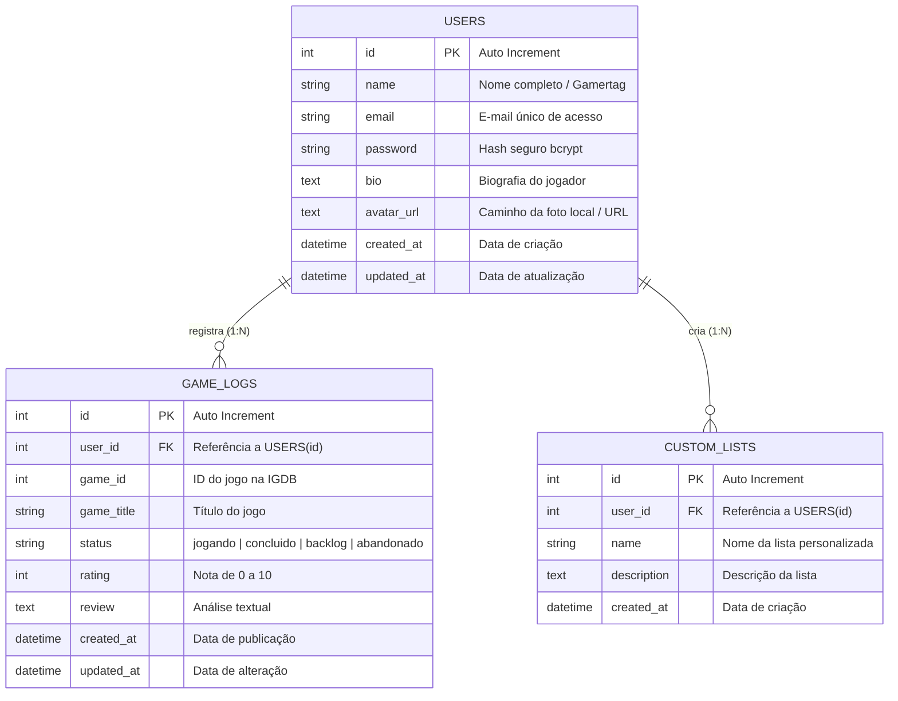

# 🗄️ Documentação de Banco de Dados — SavePoint

**Instituição:** Instituto Federal da Bahia (IFBA) — Campus Eunápolis  
**Curso:** Análise e Desenvolvimento de Sistemas (ADS) — Turma 2025  
**Disciplina:** Programação Web  
**Docente:** Profª. Ana Cristina O. Linhares  
**Projeto:** SavePoint (Etapa 3 - Final)

---

## 1. Visão Geral e Modelo Conceitual

O banco de dados do **SavePoint** foi modelado para gerenciar a jornada de usuários entusiastas de jogos digitais, permitindo catalogar jogos, organizar backlogs pessoais, publicar notas e análises críticas da comunidade, além de criar listas temáticas personalizadas.

### Entidades Identificadas:
1. **Usuário (`users`):** Representa o usuário cadastrado no sistema, com suas credenciais de autenticação, dados de perfil (nome, biografia) e foto de avatar.
2. **Registro de Jogo (`game_logs`):** Representa o registro individual de um jogo vinculado a um usuário específico. Contém o status de progresso (*jogando*, *concluido*, *backlog*, *abandonado*), nota atribuída (0 a 10) e a crítica/review textual.
3. **Lista Personalizada (`custom_lists`):** Representa agrupamentos temáticos criados pelo usuário (ex: "Top RPGs", "Zerar em 2026", "Favoritos").

---

## 2. Modelo Entidade-Relacionamento (MER)

### Cardinalidades e Regras de Negócio:
- **Usuário ➔ Registros de Jogo (1 : N):**
  - Um usuário pode registrar **zero ou muitos** jogos em seu backlog.
  - Cada registro de jogo pertence obrigatoriamente a **um único** usuário.
  - Se um usuário for excluído, todos os seus registros de jogos são automaticamente removidos (*CASCADE*).

- **Usuário ➔ Listas Personalizadas (1 : N):**
  - Um usuário pode criar **zero ou muitas** listas personalizadas.
  - Cada lista personalizada pertence obrigatoriamente a **um único** usuário.
  - Se um usuário for excluído, todas as suas listas são removidas (*CASCADE*).

---

## 3. Diagrama Entidade-Relacionamento (DER)

---

## 4. Modelo Lógico Relacional (Esquema de Tabelas)

- **USERS** (<ins>id</ins>, name, email, password, bio, avatar_url, created_at, updated_at)
- **GAME_LOGS** (<ins>id</ins>, *user_id*, game_id, game_title, status, rating, review, created_at, updated_at)  
  *user_id* referencia **USERS(id)** no evento `ON DELETE CASCADE`
- **CUSTOM_LISTS** (<ins>id</ins>, *user_id*, name, description, created_at)  
  *user_id* referencia **USERS(id)** no evento `ON DELETE CASCADE`

---

## 5. Dicionário de Dados

### Tabela: `users`
| Coluna | Tipo de Dado | Nulo? | Chave | Descrição / Regra |
| :--- | :--- | :---: | :---: | :--- |
| `id` | INT AUTO_INCREMENT | NÃO | **PK** | Identificador único do usuário |
| `name` | VARCHAR(100) | NÃO | - | Nome exibido ou Gamertag (mín. 2 caracteres) |
| `email` | VARCHAR(191) | NÃO | **UNIQUE** | E-mail de autenticação único |
| `password` | VARCHAR(255) | NÃO | - | Senha armazenada via hash bcrypt |
| `bio` | TEXT | SIM | - | Descrição pessoal do perfil |
| `avatar_url` | TEXT | SIM | - | Caminho relativo da imagem ou URL predefinida |
| `created_at` | DATETIME | NÃO | - | Data e hora de criação da conta |
| `updated_at` | DATETIME | NÃO | - | Data e hora da última modificação |

### Tabela: `game_logs`
| Coluna | Tipo de Dado | Nulo? | Chave | Descrição / Regra |
| :--- | :--- | :---: | :---: | :--- |
| `id` | INT AUTO_INCREMENT | NÃO | **PK** | Identificador único do registro de jogo |
| `user_id` | INT | NÃO | **FK** | Referência ao usuário proprietário |
| `game_id` | INT | NÃO | INDEX | ID numérico do jogo (catálogo mundial IGDB) |
| `game_title` | VARCHAR(255) | NÃO | - | Nome oficial do jogo |
| `status` | ENUM / VARCHAR(50)| NÃO | - | Status: `jogando`, `concluido`, `backlog`, `abandonado` |
| `rating` | TINYINT UNSIGNED | SIM | - | Avaliação de 0 a 10 (impede notas negativas) |
| `review` | TEXT | SIM | - | Crítica pessoal do jogador |
| `created_at` | DATETIME | NÃO | - | Data de registro no backlog |
| `updated_at` | DATETIME | NÃO | - | Data da última alteração de status/nota |

### Tabela: `custom_lists`
| Coluna | Tipo de Dado | Nulo? | Chave | Descrição / Regra |
| :--- | :--- | :---: | :---: | :--- |
| `id` | INT AUTO_INCREMENT | NÃO | **PK** | Identificador único da lista |
| `user_id` | INT | NÃO | **FK** | Referência ao usuário proprietário |
| `name` | VARCHAR(150) | NÃO | - | Título da lista (ex: "Top RPGs") |
| `description` | TEXT | SIM | - | Descrição do propósito da lista |
| `created_at` | DATETIME | NÃO | - | Data de criação da lista |

---

## 6. Script de Criação SQL (DDL)

O script completo para execução no MySQL / phpMyAdmin ou em qualquer SGBD compatível encontra-se no arquivo [database/schema.sql](file:///c:/Users/Unnamed/Documents/SavePointWeb/database/schema.sql).

